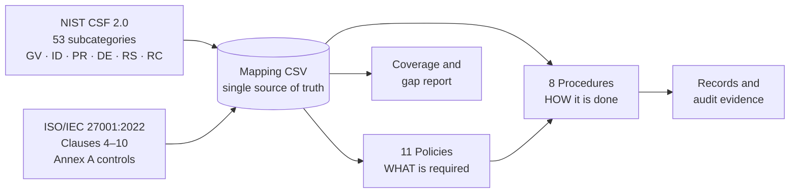

# 🛡️ NIST CSF 2.0 × ISO/IEC 27001:2022 Policy & Procedure Framework

[](https://github.com/bigsteve011/isms-policy-as-code/actions/workflows/validate-mapping.yml)


A complete, audit-ready **information security policy framework** for a fictional EU payments company, **Meridian Payments**. Every policy and procedure is traced to **NIST CSF 2.0** outcomes and **ISO/IEC 27001:2022** clauses and Annex A controls.

It is managed as **docs-as-code**. One mapping file is the source of truth, a Python script validates it and generates the traceability sections in every document, and CI blocks changes that would break the mapping.

---

## 🎯 What This Project Shows

| Capability | Where to Look |
| :--- | :--- |
| Writing clear, testable policies ("shall" statements, owners, SLAs) | [`policies/`](policies) |
| Turning policy into repeatable, evidence-producing procedures | [`procedures/`](procedures) |
| Framework mapping: NIST CSF 2.0 ↔ ISO 27001 clauses and Annex A | [`mapping/csf-iso27001-mapping.csv`](mapping/csf-iso27001-mapping.csv) |
| Coverage and gap analysis | [`mapping/COVERAGE.md`](mapping/COVERAGE.md) |
| Regulatory alignment (DORA, GDPR, PCI DSS v4.0) | POL-04, POL-05, POL-06, PRC-03 |
| Risk-based governance (appetite, 5×5 scoring, treatment) | [POL-10](policies/POL-10-risk-management-policy.md), [risk register](templates/risk-register.csv) |
| Compliance automation and document control | [`scripts/build_mapping.py`](scripts/build_mapping.py), [CI workflow](.github/workflows/validate-mapping.yml) |

---

## 🗺️ How It Fits Together



---

## 📚 Document Library

### Policies

| ID | Policy | Primary CSF Functions | Key ISO 27001 Controls |
| :--- | :--- | :--- | :--- |
| [POL-01](policies/POL-01-information-security-policy.md) | Information Security Policy | GOVERN, IDENTIFY | Cl. 4–10, A.5.1, A.5.2, A.5.35 |
| [POL-02](policies/POL-02-access-control-policy.md) | Access Control | PROTECT | A.5.15–5.18, A.8.2, A.8.5 |
| [POL-03](policies/POL-03-asset-management-and-data-protection-policy.md) | Asset Management and Data Protection | IDENTIFY, PROTECT | A.5.9, A.5.12, A.8.24 |
| [POL-04](policies/POL-04-incident-management-policy.md) | Incident Management | DETECT, RESPOND, RECOVER | A.5.24–5.28, A.6.8 |
| [POL-05](policies/POL-05-business-continuity-and-backup-policy.md) | Business Continuity and Backup | PROTECT, RECOVER | A.5.29, A.5.30, A.8.13, A.8.14 |
| [POL-06](policies/POL-06-third-party-security-policy.md) | Third-Party Security | GOVERN | A.5.19–5.23 |
| [POL-07](policies/POL-07-vulnerability-configuration-and-network-security-policy.md) | Vulnerability, Configuration and Network Security | IDENTIFY, PROTECT | A.5.7, A.8.8, A.8.9, A.8.20 |
| [POL-08](policies/POL-08-logging-and-monitoring-policy.md) | Logging and Monitoring | PROTECT, DETECT | A.8.15, A.8.16, A.8.17 |
| [POL-09](policies/POL-09-acceptable-use-and-security-awareness-policy.md) | Acceptable Use and Security Awareness | GOVERN, PROTECT | A.6.1–6.5 |
| [POL-10](policies/POL-10-risk-management-policy.md) | Risk Management | GOVERN, IDENTIFY | Cl. 6.1.2, 6.1.3, 8.2, 8.3 |
| [POL-11](policies/POL-11-secure-development-policy.md) | Secure Development | PROTECT | A.8.25, A.8.28, A.8.29 |

### Procedures

| ID | Procedure | Parent Policy |
| :--- | :--- | :--- |
| [PRC-01](procedures/PRC-01-user-access-review-procedure.md) | User Access Review | POL-02 |
| [PRC-02](procedures/PRC-02-joiner-mover-leaver-procedure.md) | Joiner-Mover-Leaver | POL-02, POL-09 |
| [PRC-03](procedures/PRC-03-incident-response-procedure.md) | Incident Response | POL-04 |
| [PRC-04](procedures/PRC-04-vulnerability-remediation-procedure.md) | Vulnerability Remediation | POL-07 |
| [PRC-05](procedures/PRC-05-backup-and-restore-testing-procedure.md) | Backup and Restore Testing | POL-05 |
| [PRC-06](procedures/PRC-06-supplier-security-assessment-procedure.md) | Supplier Security Assessment | POL-06 |
| [PRC-07](procedures/PRC-07-risk-assessment-procedure.md) | Risk Assessment | POL-10 |
| [PRC-08](procedures/PRC-08-policy-lifecycle-procedure.md) | Policy Lifecycle (Document Control) | POL-01 |

### Templates
- [Policy Exception Request](templates/policy-exception-request.md)
- [Risk Register](templates/risk-register.csv) (with sample entries mapped to Annex A and CSF)

---

## 📊 Coverage at a Glance

| CSF Function | Subcategories Mapped | Strong Fit | Partial Fit |
| :--- | ---: | ---: | ---: |
| GOVERN | 13 | 11 | 2 |
| IDENTIFY | 10 | 8 | 2 |
| PROTECT | 15 | 14 | 1 |
| DETECT | 5 | 5 | 0 |
| RESPOND | 7 | 7 | 0 |
| RECOVER | 3 | 2 | 1 |
| **Total** | **53** | **47** | **6** |

The full report is in [`mapping/COVERAGE.md`](mapping/COVERAGE.md). It includes Annex A coverage by theme, a reverse index from each control to its CSF subcategories, and the partial mappings that need supplementary controls.

---

## ⚙️ Docs-as-Code Workflow

```bash
# Validate the mapping and regenerate the traceability sections and the coverage report
python3 scripts/build_mapping.py

# CI mode: fail if the mapping is invalid or the generated files are stale
python3 scripts/build_mapping.py --check
```

The script checks that:
- CSF IDs are well-formed, unique and belong to the stated function
- ISO clauses and Annex A references are valid ISO 27001:2022 identifiers (93 controls, themes 5–8)
- every subcategory has an owning policy, and every referenced policy or procedure file exists
- the generated sections in each document match the mapping

No dependencies are needed beyond the Python 3.10+ standard library.

---

## 📐 Methodology

The mapping is outcome-based. Each CSF subcategory is mapped to the ISO 27001 requirements that would produce that outcome, and the fit is rated **Strong** or **Partial**. See [`docs/methodology.md`](docs/methodology.md) for the approach, sources and limitations.

---

## ⚠️ Disclaimer

Meridian Payments is a **fictional organisation**. The documents are portfolio samples and templates. Adapt them to your organisation's context, risk appetite and legal advice before using them. ISO/IEC standards are copyrighted: this repository refers to control numbers only and does not reproduce the standards' text.

---

**Author:** [Stephen Omowumi](https://www.linkedin.com/in/stephen-omowumi-6b59b14a/) · ISO/IEC 27001 Lead Auditor · CySA+ · Security+
